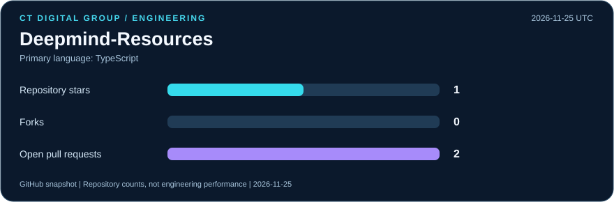

<div align="center">

# DeepMind Resources

### Understand AI. Practise with it. Build real capability.

**AI learning · Practical exercises · Skills development**

[Explore the platform](https://deepmindresources.pro) · [Browse the Academy](https://deepmindresources.pro/academy) · [Visit CT DIGITAL GROUP](https://ctdigital.group/)

</div>

---

## From AI updates to useful skills

DeepMind Resources is an AI learning and resources project focused on turning new AI developments into clear explanations, practical lessons and hands-on exercises.

The product direction is straightforward:

**AI update → verified meaning → practical lesson → sandbox task → measurable user skill gain**

The aim is to help people do more than follow AI announcements: understand what changed, see why it matters and practise using the capability.

## What the project contains

| Area | Focus |
| --- | --- |
| **Academy** | Structured learning paths, modules and lessons |
| **Practice sandbox** | Exercises that help learners apply and improve prompts |
| **AI tools and intelligence** | Resources for understanding and exploring useful AI tools |
| **Business AI training** | Learning materials oriented around practical business use |
| **Personal dashboard** | Learner-facing workspace and progress-related experiences |

These areas are represented in the repository. **Their presence in source code is not a claim that every feature is finished or publicly available.** Development and refinement are ongoing.

## Technology

The repository uses:

- Next.js App Router, React and TypeScript
- Tailwind CSS and reusable UI components
- Supabase integration
- API routes and server-side application logic

See [package.json](./package.json) for the actual dependency versions.

## Development approach

- **Teach, don't just describe.** Lessons should include a practical example, common mistake, recap, practice and understanding check.
- **Keep examples grounded.** Avoid invented claims, fake activity data and unsupported product promises.
- **Build for learners.** Clear, accessible, responsive interfaces come before decorative complexity.
- **Verify changes.** Review the affected files and run the project build for code changes.
- **Protect user data.** Never commit secrets, credential files, private exports or database dumps.

## Local development

Requires a supported Node.js installation and the environment settings appropriate to the features being tested.

```bash
npm ci
npm run dev
```

For production build verification:

```bash
npm run build
```

Use the environment **variable names** documented in [AGENTS.md](./AGENTS.md); do not commit real values.

## Status

**Active development.** The repository is public to show the project's architecture and progress. Not every planned capability should be treated as a shipped feature.

## Explore

**[DeepMind Resources website](https://deepmindresources.pro)**

**[CT DIGITAL GROUP](https://ctdigital.group/)** — the wider digital and AI systems business.

---

<div align="center">

*Learn with clarity. Practise with purpose. Keep improving.*

</div>
<!-- CTDG-ENGINEERING-START -->
## CTDG engineering intelligence

    



| Repository detail | Verified snapshot |
| --- | --- |
| Primary language | TypeScript |
| Repository stars | 1 |
| Forks | 0 |
| Open pull requests | 2 |
| Data date (UTC) | 2026-11-25 |

[CT DIGITAL GROUP](https://ctdigital.group/) · [Repository activity](https://github.com/colintandyonline/Deepmind-Resources/activity) · [Pull requests](https://github.com/colintandyonline/Deepmind-Resources/pulls)

Statistics are a point-in-time GitHub snapshot, not an indication of release readiness.
<!-- CTDG-ENGINEERING-END -->
